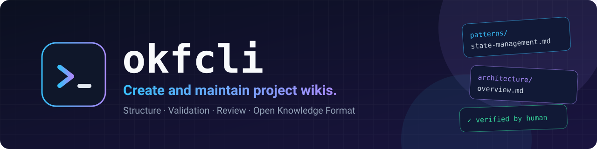
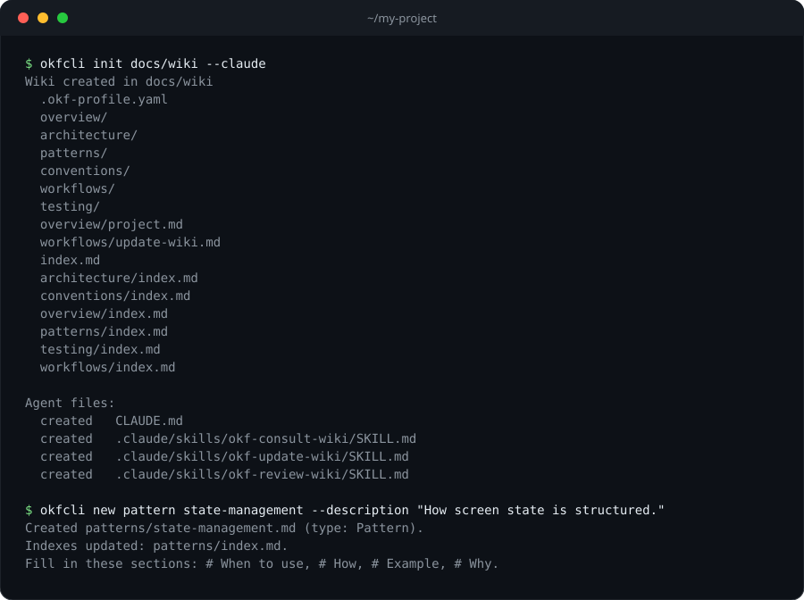

<div align="center">



<br>

[](https://www.npmjs.com/package/okfcli)
[](https://github.com/lucasdeprit/okfcli/actions/workflows/ci.yml)
[](LICENSE)
[](#1-instalar)

**Una CLI para crear y mantener wikis de proyecto en [Open Knowledge Format (OKF)](https://github.com/GoogleCloudPlatform/open-knowledge-format).**

[Inicio rápido](#inicio-rápido) · [Comandos](#comandos) · [Compatibilidad con agentes](#compatibilidad-con-agentes) · [Spec](SPEC.md) · [Contribuir](CONTRIBUTING.md) · [English](README.md)

</div>

---

okfcli crea la estructura de la wiki (carpetas, índices y plantillas de página), la valida contra la [spec](SPEC.md), registra qué páginas ha revisado una persona y conecta la wiki con tus agentes de código. Los agentes escriben el contenido; la CLI se encarga de la parte mecánica.

## Inicio rápido

### 1. Instalar

```bash
npm install -g okfcli
```

Requiere Node 22 o superior. También puedes ejecutarlo sin instalar, con `npx okfcli`.

<details>
<summary><b>Fijar o actualizar la versión</b></summary>

Fija una versión con `npm install -g okfcli@0.2.0`. Para actualizar, vuelve a instalar y ejecuta `okfcli init` en cada proyecto para refrescar los ficheros de agentes generados.

</details>

### 2. Crear la wiki y conectar tu agente

```bash
okfcli init docs/wiki --claude
```

<p align="center">
  
</p>

Usa `--copilot`, `--claude`, `--codex`, `--opencode` o `--cursor` según los agentes que uses (ver [Compatibilidad con agentes](#compatibilidad-con-agentes)).

### 3. Rellenarla y comprobarla

Pide a tu agente que escriba el contenido, por ejemplo:

```text
Update this project's wiki from the current source and tests.
```

El agente crea las páginas con `okfcli new`, que también puedes ejecutar tú:

```bash
okfcli new pattern state-management --description "How screen state is structured."
```

Cuando una página tenga contenido, comprueba la wiki y márcala como revisada:

```bash
okfcli validate
okfcli verify patterns/state-management --by human:ana
```

## Comandos

| Comando | Qué hace |
|---|---|
| `okfcli init [folder]` | Crea la wiki (por defecto `./wiki`) y la conecta con tus agentes de código. `--template minimal` crea solo las dos páginas obligatorias |
| `okfcli new <type> <name> --description "..."` | Crea una página desde su plantilla y la añade al índice |
| `okfcli validate [--fix]` | Comprueba la wiki y lista las páginas que nadie ha revisado. `--fix` repara lo que es mecánico |
| `okfcli verify <path> --by human:<id>` | Marca una página como revisada |

- **Tipos para `new`:** `overview` `architecture` `pattern` `convention` `workflow` `testing` `feature` `module` `interface` `operation` `troubleshooting`
- **Todos los comandos:** `--json` para salida legible por máquinas, `--wiki <folder>` para elegir la wiki (si no, se busca desde el directorio actual)
- **Ayuda:** `okfcli --help`, `okfcli <command> --help`

## Validación y revisión

- **Comprobaciones:** `validate` cubre la estructura de carpetas, el frontmatter, las secciones obligatorias, los enlaces, las páginas huérfanas, los marcadores TODO sin rellenar y los índices desactualizados. La severidad de cada regla se puede cambiar en `.okf-profile.yaml`.
- **Reparaciones:** `validate --fix` regenera los índices, recrea las carpetas y páginas obligatorias que falten y añade los encabezados de sección que falten. No escribe contenido.
- **CI:** `validate --json` devuelve los problemas en JSON. El código de salida es 1 si hay errores; con `--strict` también falla ante avisos.
- **Revisión:** una página cuenta como sin revisar hasta que alguien ejecuta `okfcli verify`. Si una página verificada cambia después, `validate` la marca como desactualizada. `verify` rechaza las páginas que aún tienen marcadores TODO salvo que uses `--force`.
- **Historial:** la wiki no guarda ficheros de historial; de eso se encarga git.

## Qué se genera

```
docs/wiki/
├── index.md
├── .okf-profile.yaml     ajustes: carpetas y páginas obligatorias, carpetas extra, severidad de reglas
├── overview/             qué es el proyecto
├── architecture/         estructura y reglas
├── patterns/             cómo implementamos las cosas
├── conventions/          estilo y nombres
├── workflows/            cómo trabajamos
├── testing/              cómo probamos
└── (features/ modules/ interfaces/ operations/ troubleshooting/)  opcionales, las crea `okfcli new`
```

Esta es la plantilla `development`, la de por defecto. Para proyectos que no son de software, `okfcli init --template minimal` crea solo `overview/project.md` y `workflows/update-wiki.md`. Qué carpetas y páginas son obligatorias se define en `.okf-profile.yaml`, así que puedes cambiarlo después.

Cada carpeta tiene un `index.md` generado. Cada página tiene `type`, `title` y `description`, además de las secciones que exige su tipo.

## Compatibilidad con agentes

`okfcli init` escribe los ficheros que conectan la wiki con tus agentes de código. Pasa una flag por herramienta; sin ninguna flag conecta GitHub Copilot.

| Agente | Flag | Bloque de instrucciones en | Skills en |
|---|---|---|---|
| GitHub Copilot | `--copilot` (por defecto) | `AGENTS.md`, o `.github/copilot-instructions.md` si el proyecto ya lo usa | `.github/skills/` |
| Claude Code | `--claude` | `CLAUDE.md` (o `.claude/CLAUDE.md`) | `.claude/skills/` |
| Codex | `--codex` | `AGENTS.md` | `.agents/skills/` |
| OpenCode | `--opencode` | `AGENTS.md` | `.agents/skills/` |
| Cursor | `--cursor` | `AGENTS.md` | `.agents/skills/` |

```bash
okfcli init --claude --codex     # varios a la vez
```

`init` añade un bloque corto al fichero de instrucciones, para que el agente sepa que la wiki existe, e instala tres skills: `okf-consult-wiki`, `okf-update-wiki` y `okf-review-wiki`. Las skills llaman a `okfcli`, así que debe estar instalado en las máquinas donde corren los agentes.

<details>
<summary><b>Detalles</b></summary>

- `init` nunca borra ficheros, así que los de un agente que dejes de pasar se quedan donde están.
- Ejecuta `okfcli init` de nuevo para refrescar los ficheros de agentes. Nunca toca las páginas de la wiki.
- `--no-agents` omite los ficheros de agentes.
- Las skills siguen el formato abierto [agentskills.io](https://agentskills.io). Añadir otra herramienta es una línea en `src/generate/targets.ts`.

</details>

## Desarrollo

```bash
npm install
npm test                          # compila a dist/ y ejecuta los tests
node dist/bin/okfcli.js --help    # ejecutar desde un clon
```

## Contribuir

Ver [CONTRIBUTING.md](CONTRIBUTING.md). Problemas de seguridad: [SECURITY.md](SECURITY.md).

## Licencia

[MIT](LICENSE)
