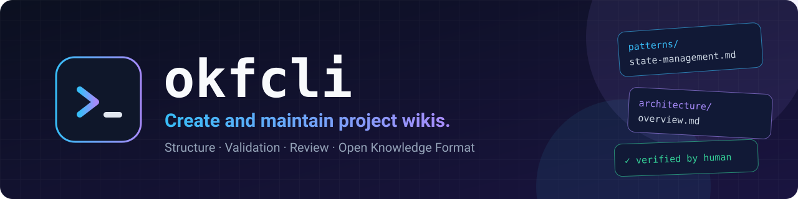
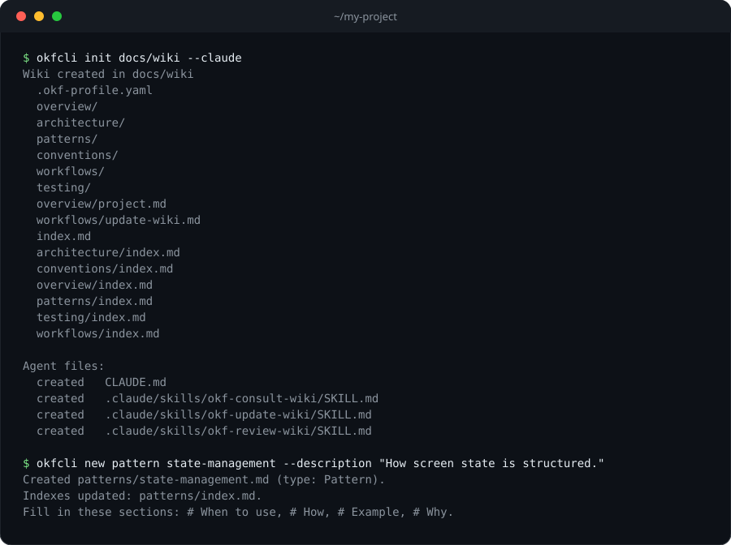

<div align="center">



<br>

[](https://www.npmjs.com/package/okfcli)
[](https://github.com/lucasdeprit/okfcli/actions/workflows/ci.yml)
[](LICENSE)
[](#install)

**Create and maintain project wikis in [Open Knowledge Format (OKF)](https://github.com/GoogleCloudPlatform/open-knowledge-format), with the same structure in every project.**

[Quick start](#quick-start) · [Commands](#commands) · [Agents](#agents) · [Spec](SPEC.md) · [Contributing](CONTRIBUTING.md)

</div>

---

## Why okfcli

| | |
|---|---|
| 🗂️ **Same structure everywhere** | Folders, indexes and page skeletons generated for you. Nobody edits `index.md` by hand. |
| 🤖 **Agent-ready** | One flag connects Copilot, Claude Code, Codex, OpenCode or Cursor, with consult/update/review skills. |
| ✅ **Human-reviewed** | A page is unreviewed until someone verifies it. Changed after review? `validate` flags it as outdated. |
| 🔍 **Checkable** | `okfcli validate` enforces the [spec](SPEC.md); `--fix` repairs the mechanical issues. `--json` for CI. |

## Quick start

<p align="center">
  
</p>

```bash
npx okfcli init docs/wiki --claude
```

## Commands

| Command | What it does |
|---|---|
| `okfcli init [folder]` | Create the wiki (default `./wiki`) and connect it to your coding agents (Copilot by default; `--claude`, `--codex`, `--opencode`, `--cursor`). `--template minimal` creates only the two required pages |
| `okfcli new <type> <name> --description "..."` | Create a page from its template and add it to the index |
| `okfcli validate [--fix]` | Check the wiki and list what nobody has reviewed. `--fix` repairs the mechanical issues |
| `okfcli verify <path> --by human:<id>` | Mark a page as reviewed |

```bash
okfcli init docs/wiki
okfcli new pattern state-management --description "How screen state is structured."
okfcli validate --fix
okfcli verify patterns/state-management --by human:ana
```

- **Types for `new`:** `overview` `architecture` `pattern` `convention` `workflow` `testing` `feature` `module` `interface` `operation` `troubleshooting`
- **Every command:** `--json` for machine-readable output, `--wiki <folder>` to pick a wiki (otherwise it is found from the current directory)
- **Help:** `okfcli --help`, `okfcli <command> --help`

## Install

Needs Node 22 or later.

```bash
npm install -g okfcli          # gives you the `okfcli` command
npx okfcli init docs/wiki      # or run it without installing
```

Pin a version with `npm install -g okfcli@0.1.0`. To upgrade, install again, then run `okfcli init` in each project to refresh the generated agent files.

## What you get

```
docs/wiki/
├── index.md
├── .okf-profile.yaml     settings: required folders and pages, extra folders, rule severities
├── overview/             what the project is
├── architecture/         structure and rules
├── patterns/             how we implement things
├── conventions/          style and naming
├── workflows/            how we work
├── testing/              how we test
└── (features/ modules/ interfaces/ operations/ troubleshooting/)  optional, created by `okfcli new`
```

This is the `development` template, the default. For anything that is not a software project, `okfcli init --template minimal` creates just `overview/project.md` and `workflows/update-wiki.md`. Which folders and pages are required is written in `.okf-profile.yaml`, so you can edit it later.

Every folder has an `index.md`, generated for you. Every page has `type`, `title` and `description`, plus the sections its type requires.

## How it works

- **The CLI does the mechanical work:** folders, indexes, page skeletons, structure checks. Nobody edits `index.md` by hand.
- **Agents write the content:** they fill in the sections of the pages `okfcli new` creates.
- **People review:** a page is unreviewed until someone runs `okfcli verify` (or writes the `verified` entry by hand). If a verified page changes afterwards, `validate` reports it as outdated.
- **No history files:** the history of the wiki is left to git.

## Agents

`okfcli init` also writes, relative to the directory where you run it, the files that connect the wiki to your coding agents. Pass one flag per tool you use; without any flag it connects GitHub Copilot:

```bash
okfcli init                      # Copilot
okfcli init --claude             # Claude Code
okfcli init --claude --codex     # several at once
```

| Flag | Pointer block in | Skills in |
|---|---|---|
| `--copilot` (default) | `AGENTS.md` (or `.github/copilot-instructions.md` if that is what the project uses) | `.github/skills/` |
| `--claude` | `CLAUDE.md` | `.claude/skills/` |
| `--codex`, `--opencode`, `--cursor` | `AGENTS.md` | `.agents/skills/` |

The pointer block makes the agent always know the wiki exists. The three skills are `okf-consult-wiki`, `okf-update-wiki` and `okf-review-wiki`. `okfcli` never deletes files, so files of an agent you stop passing stay where they are.

The skills call `okfcli`, so install it globally on the machines where agents run. Run `okfcli init` again to refresh these files; it never touches the wiki pages. `--no-agents` skips them.

## Contract

The rules a wiki must follow (folders, page types, required sections, review, checks) are in [SPEC.md](https://github.com/lucasdeprit/okfcli/blob/main/SPEC.md).

## Development

```bash
npm install
npm test                          # builds to dist/ and runs the tests
node dist/bin/okfcli.js --help    # run from a clone
```

## Contributing

See [CONTRIBUTING.md](CONTRIBUTING.md). Security issues: [SECURITY.md](SECURITY.md).

## License

[MIT](LICENSE)
